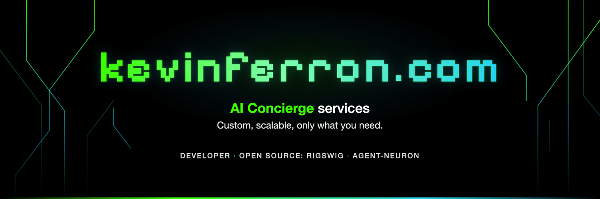

# Kevin Ferron

I'm a software developer, and I run **KFTCDA**, offering custom, scalable, only-what-you-need **AI Concierge
services** to small businesses. Assistants draft the replies, quotes and follow-ups, and a
person approves each one before it goes out.

**→ [Find your kind of business](https://kevinferron.com/concierge)**: tell me about it in a few lines and see what
an AI Concierge could take off your plate.


**→ [Every business type](https://kevinferron.com/for)** · **[KFTCDA Elite AI Enablement](https://kevinferron.com/kftcda/ai-enablement)**

Before this I was Director of Engineering at Zynga, CTO at Booyah and a tech lead at Electronic Arts, and I wrote
embedded C++ and Rust firmware for DC fast chargers. You work directly with the engineer doing the work.

## Open source

**[rigswig](https://github.com/overfocus/rigswig)** shows everything your coding agent loads before you type,
and where each piece came from. It works with any harness, runs locally and only reads. Written in Rust.

```sh
brew install overfocus/tap/rigswig
```

[Lab page and release notes](https://kevinferron.com/lab/rigswig) · [Homebrew tap](https://github.com/overfocus/homebrew-tap)

**The agent-neuron family** is an experimental agent graph. Each agent runs in the same wrapper, and the network's
rules are data a team can read, argue with and version.

- [agent-neuron](https://github.com/overfocus/agent-neuron): the protocol and its engines (Rust, TypeScript, Python)
- [agent-neuron-viz](https://github.com/overfocus/agent-neuron-viz): Neuron Space, a 3D view of a network, driven by the engine over MCP
- [agent-neuron-demos](https://github.com/overfocus/agent-neuron-demos): people and agents deciding together on the engine's desk
- [The series on kevinferron.com](https://kevinferron.com/lab/agent-neuron)

## Elsewhere

- Site: [kevinferron.com](https://kevinferron.com) · [Lab](https://kevinferron.com/lab) · [Repos](https://kevinferron.com/lab/repos)
- LinkedIn: [linkedin.com/in/kferron](https://www.linkedin.com/in/kferron)
- X: [@KevinFerron](https://x.com/KevinFerron)
- Email: [kcf@kevinferron.com](mailto:kcf@kevinferron.com)
